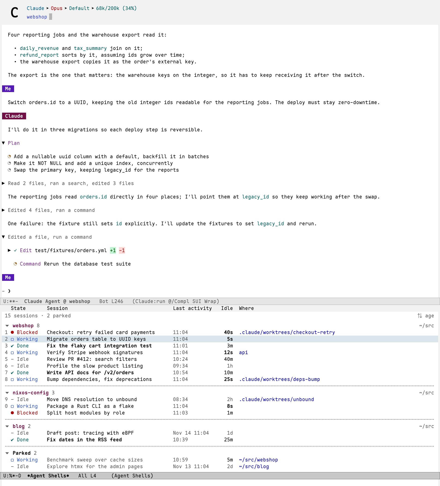
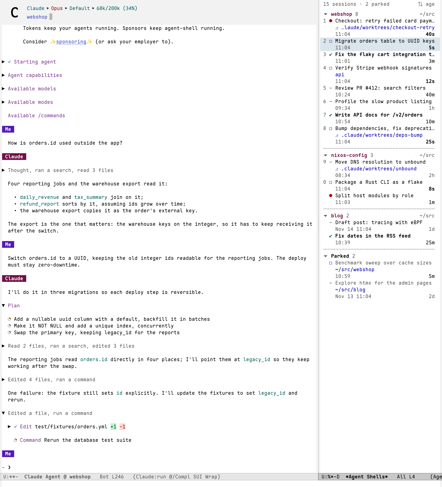

# agent-shell-overview

An overview of the [agent-shell](https://github.com/xenodium/agent-shell)
sessions, in a side window of Emacs. Each session shows its state (working,
waiting for an answer, done, idle), title, last activity, idle time and
directory, grouped by project, with worktrees under their main project, or
listed as one (`agent-shell-overview-group-by-project`, toggled with `G`).
From the list, you preview a session, jump to it, interrupt, reload, restart,
kill, mark it unread or mute it; a muted session never asks for attention and
moves to a Parked group. The rows of the sessions shown in a window of the
frame are tinted. At the bottom or top of the frame the overview is a table; on the left
or right, a narrow list, with one line per session in compact mode
(`agent-shell-overview-compact`, toggled with `C`).

Horizontal layout (a panel at the top or bottom of the frame):



Vertical layout (a panel on the left or right side):



The sessions in these screenshots are made up.

## Install

Not on MELPA yet. Once it is: `M-x package-install RET agent-shell-overview`.

With `use-package` (Emacs 30 or later):

```elisp
(use-package agent-shell-overview
  :vc (:url "https://github.com/fjolliton/agent-shell-overview")
  :bind ("C-c o" . agent-shell-overview)
  :custom (agent-shell-overview-side 'right)  ; bottom (default), top, left
  :config
  (agent-shell-overview-tracking-mode 1))
```

`agent-shell-overview-tracking-mode` follows the shells' turns to tell which
ones finished unseen. The overview enables it when first shown; enabling it at
startup also catches the turns that end before then.

Any key will do; the author binds `agent-shell-overview` to `F10` and
`agent-shell-overview-cycle-side` to `S-F10`.

## Keys

| Key           | Action                                            |
|---------------|---------------------------------------------------|
| `RET`         | Show the session and select it                    |
| `S-RET`       | Show the session, select it, close the overview   |
| `1`–`9`, `0`  | Show the first ten shells, as `RET`               |
| `SPC`         | Show the session, keeping the focus               |
| `n` / `p`     | Next / previous session, shown                    |
| `TAB` / `S-TAB` | Next / previous session asking for attention    |
| `TAB` on a group | Fold or unfold the group (`S-TAB`: all)        |
| `S` / `f`     | Cycle the sort / the filter                       |
| `G`           | Group by project, or list all sessions as one     |
| `C`           | One line per session on the side, or several      |
| `u`           | Mark unread / read                                |
| `z`           | Mute / unmute                                     |
| `k`           | Kill                                              |
| `c` / `N`     | New shell / new shell in the session's project    |
| `r` / `R`     | Reload (resume the session) / restart (new one)   |
| `m` / `M`     | Set the session mode / model                      |
| `C-c C-c`     | Interrupt                                         |
| `t` / `l`     | View traffic / toggle logging                     |
| `w`           | Move the overview to the next side                |
| `g` / `q`     | Refresh / close                                   |
| `mouse-1` / `mouse-3` | Show the session / context menu           |

## Extending

States, columns and extra rows are open to extensions; see the Commentary of
`agent-shell-overview.el` and the docstrings of the variables below. For
example, a state of your own and a column:

```elisp
(add-hook 'agent-shell-overview-state-functions
          (lambda (buffer) (and (my-agent-crashed-p buffer) 'crashed)))
(push '(crashed "⚠" "Crashed" agent-shell-overview-blocked nil)
      agent-shell-overview-states)
(push 'crashed agent-shell-overview-attention-states)
(agent-shell-overview-add-column
 '("Mem" 5 my-memory-cell :right-align t :pad-right 2)
 'agent-shell-overview-column-title)
```

Rows that are not shell buffers come from `agent-shell-overview-entry-functions`;
`agent-shell-overview-refresh-hook` runs on each polling tick;
`agent-shell-overview-mute-functions` runs after a shell is muted or unmuted.
Projects come from project.el, so `.project` files and `project-find-functions`
apply; `agent-shell-overview-worktree-functions` lifts a worktree to its main
project (git worktrees, also of bare repositories, by default).


## Known limitations

- A turn the agent starts on its own, without a prompt from you, shows as
  Idle while it runs and is never marked Done: agent-shell reports a shell as
  busy only while a prompt is in progress.
- Questions from the agent (permissions, elicitations) emit no event; the
  overview sees them on its next poll, within a second.
- A session restored without replaying its history (agent-shell's default
  `minimal` restore, with agents supporting `session/resume`) shows the time
  of its restore as its last activity.
- Worktrees are grouped under their main project for git only; other version
  control systems need a function on `agent-shell-overview-worktree-functions`.
- The overview redraws only in its side window: shown in an ordinary window,
  it doesn't follow `G`, `S` or `f` until it is back in its panel.
- The session title is read from agent-shell's internal state; if that
  changes upstream, the overview falls back to the buffer name.

## Authorship

This package was written by Claude, Anthropic's AI model, on behalf of
Frédéric Jolliton, who reviews and maintains it.
